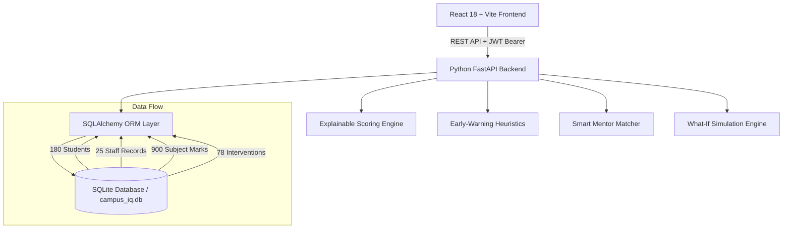

# 🎓 Gradewise-AI — AI-Powered Student Analytics & Success Platform

> **Smart Campus Analytics: Predict, Optimize & Improve Student Success**  
> *Recognizing high performers while actively accelerating medium-performing and struggling students through explainable AI roadmaps, trackable mentorship, and gamified mastery.*

[](https://fastapi.tiangolo.com)
[](https://vitejs.dev)
[](https://tailwindcss.com)
[](https://www.sqlite.org)
[](https://pandas.pydata.org)
[-success?style=for-the-badge&logo=pytest&logoColor=white)](https://pytest.org)

---

## 🌟 Executive Summary & Hackathon Story

Traditional higher-education portals only notify students and faculty when failure has already occurred—such as when a student is debarred from final exams due to low attendance or fails midterms.

**CampusIQ changes the paradigm from punitive reporting to proactive growth:**
1. **Explainable Early-Warning Heuristics:** Evaluates attendance, assignment completion, LMS reading hours, and placement screening before exams occur, providing clear evidence behind every flag.
2. **Growth Recognition over Pure Grades (The Comeback Score):** Rewards students who improve from 42% to 65%, acknowledging positive momentum and daily practice streaks.
3. **Actionable Remediation:** Connects struggling students to faculty mentors through **Smart Mentor Matching** (load-balanced by faculty research specialization and open capacity) and sequential learning roadmaps.

---

## 🏛️ System Architecture



---

## 🔑 Demo Account Credentials

Use the **1-Click Demo Switcher** directly on the Login page or use the credentials below:

| Persona | Role | Email / Username | Password | Purpose & Focus Area |
| :--- | :--- | :--- | :--- | :--- |
| **Dr. Campus Admin** | Admin | `admin@campusiq.edu` | `Admin@123` | Whole-campus intelligence, CSV import, reports |
| **Dr. Rajesh Kulkarni** | Faculty | `faculty.aiml@campusiq.edu` | `Faculty@123` | AIML HoD, marks entry, attendance, mentee tracker |
| **Dr. Harish Chandra** | Faculty | `faculty.cse@campusiq.edu` | `Faculty@123` | CSE HoD, Operating Systems & Networks |
| **Aarav Sharma** | Student | `student.aiml@campusiq.edu` | `Student@123` | ID: `AIML-001`, Rank #1, Balanced High Performer |
| **Rohan Gupta** | Student | `student.comeback@campusiq.edu` | `Student@123` | ID: `AIML-015`, **Comeback Champion (+18 delta)** |
| **Kunal Verma** | Student | `student.atrisk@campusiq.edu` | `Student@123` | ID: `CSE-020`, At-Risk Support, Attendance & Mentoring |

---

## 📊 Complete Synthetic College Dataset

The platform seeds a complete, reproducible synthetic engineering college dataset:
- **180 Fictional B.Tech Students:**
  - **AIML:** 60 students (20 in Year 2, 20 in Year 3, 20 in Year 4)
  - **AIDS:** 60 students (20 in Year 2, 20 in Year 3, 20 in Year 4)
  - **CSE:** 60 students (20 in Year 2, 20 in Year 3, 20 in Year 4)
- **25 Fictional Staff Records:**
  - 20 Teaching Faculty across AIML, AIDS, and CSE (HoDs, Professors, Mentors)
  - 5 Support Staff (Dean of Admin, Placement Director, LMS Coordinator, CRC Lead, Student Welfare)
- **900 Subject Marks:** Semester internal exams, assignments, laboratory scores, and grades.
- **78 Active & Resolved Interventions:** Structured mentor-mentee remedial plans.
- **Provisional Data Cases:** Includes students with intentionally missing LMS logs to demonstrate dynamic weight renormalization.

---

## 🚀 Standout Innovations (5 High-Impact Features)

### 1. 📈 Comeback Score
Tracks historical improvement delta vs baseline. A student who lifts their score from 42 to 62 is celebrated for progress and awarded growth recognition, preventing discouragement.

### 2. 🎯 Next Exam Difficulty Radar
Cross-references upcoming examination syllabus difficulty ratings against student-specific internal test deficits and unfinished practice units to generate a **Vulnerability Threat Index**.

### 3. 💼 Career Mission Mode
Converts career ambitions (*AI/ML Engineer*, *Software Developer*, *Data Analyst*, *DevOps Engineer*) into progressive skill tiers, required subjects, practical projects, and placement checklists.

### 4. 🤝 Smart Mentor Matching
An algorithmic matcher that pairs students with faculty mentors based on subject deficiency, faculty research specialization, department alignment, and mentee workload balancing (preventing faculty burnout).

### 5. 🏆 Campus Growth League
Branch-level team battle (*AIML vs AIDS vs CSE*) rewarding daily practice streaks, completed milestones, and Comeback Scores rather than cutthroat marks alone.

---

## 🧮 Explainable Scoring Formula

The **Student Success Score** is normalized from 0 to 100 with zero external API dependencies:

$$\text{Success Score} = (0.30 \times \text{Academics}) + (0.20 \times \text{Attendance}) + (0.15 \times \text{LMS}) + (0.10 \times \text{Engagement}) + (0.15 \times \text{Placement}) + (0.10 \times \text{Skills})$$

- **Provisional Score Renormalization:** If an indicator is missing, weights dynamically renormalize among available components:
  $$W_{\text{effective}} = \frac{W_i}{\sum_{k \in \text{valid}} W_k}$$

---

## 💻 Quick Start & Installation

### Prerequisites
- Python 3.10+ (tested on Python 3.14)
- Node.js 18+ (tested on Node v24)
- Git

### 1. Start Backend Server
```bash
cd backend
python -m pip install -r requirements.txt
python -m app.data.seed_data   # Seeds 180 students & 25 staff
python run.py                   # Runs FastAPI on http://localhost:8000
```

### 2. Start Frontend Server
```bash
cd frontend
npm install
npm run dev                     # Runs Vite on http://localhost:5173
```

### 3. Quick 1-Click Launch (Windows)
Double-click `scripts/start_all.bat` to launch both servers simultaneously!

---

## 🧪 Running Automated Tests

Run the backend verification suite covering authentication, scoring algorithms, provisional handling, and quiz submissions:
```bash
cd backend
python -m pytest tests/test_api.py -v
```

Or run `scripts/test_all.bat`.

---

## 🌐 Deploying to Live URL

### Option A: Render (Unified Blueprint)
1. Fork or push this repository to GitHub.
2. Link repository to [Render.com](https://render.com).
3. Select **Blueprint** and point to `render.yaml`. Both frontend and backend deploy automatically.

### Option B: Vercel (Frontend) + Render / Railway (Backend)
- **Frontend (Vercel):** Set root directory to `frontend`. Environment variable: `VITE_API_BASE=https://your-backend.onrender.com/api/v1`.
- **Backend (Render):** Deploy `backend` folder as Python Web Service with start command `uvicorn app.main:app --host 0.0.0.0 --port $PORT`.

### Option C: Docker
```bash
docker build -t campusiq:latest .
docker run -p 8000:8000 campusiq:latest
```

---

## 📁 Project Structure

```
student_analytics/
├── backend/
│   ├── app/
│   │   ├── api/             # 12 REST API routers (auth, students, faculty, etc.)
│   │   ├── core/            # Config, security (bcrypt + JWT), SQLite DB
│   │   ├── data/            # Synthetic generator (180 students, 25 staff, sample CSVs)
│   │   ├── models/          # SQLAlchemy ORM models
│   │   ├── services/        # Scoring, early-warning, segmentation, mentor matching
│   │   └── main.py          # FastAPI application
│   ├── tests/               # Pytest automated test suite
│   ├── requirements.txt
│   └── run.py
├── frontend/
│   ├── src/
│   │   ├── components/      # Navbar, Sidebar, StatCard, ScoreBreakdownModal
│   │   ├── context/         # AuthContext with 1-click judge personas
│   │   ├── pages/           # 19 connected functional views
│   │   ├── services/        # Centralized API service
│   │   └── index.css        # Tailwind design system with glassmorphism
│   ├── index.html
│   ├── package.json
│   └── vite.config.js
├── demo/
│   ├── VIDEO_PRESENTATION_SCRIPT.md   # 3-Minute presentation script
│   ├── HACKATHON_DEMO_SCRIPT.md       # Judge walkthrough & FAQ guide
│   └── TEST_EVALUATION_NOTES.md       # 20 acceptance tests audit matrix
├── scripts/
│   ├── start_all.bat        # Windows 1-click startup
│   └── test_all.bat         # Automated test runner
├── Dockerfile
├── render.yaml
├── vercel.json
└── README.md
```

---

## ⚖️ License & Hackathon Demonstration Notice

All students, faculty, grades, and marks are **synthetic demonstration data** generated for evaluation purposes. No real student records or PII are used.
